# CausalForge

**A research-oriented causal inference and decision intelligence framework built in Python.**

CausalForge brings together causal graph analysis, treatment-effect estimation, causal machine learning, sensitivity analysis, and budget-constrained policy evaluation in one reproducible research-engineering project.

It is designed around a central principle: **causal estimates should be evaluated against explicit assumptions, measurable uncertainty, and known ground truth wherever possible.**

<p align="center">
  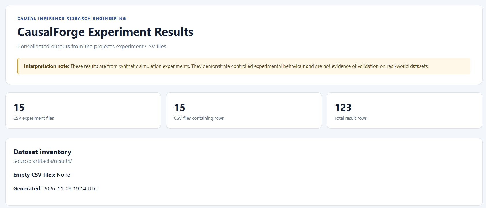
</p>

<p align="center">
  <em>Experiment dashboard generated from the project's local CSV artifacts. It consolidates simulation outputs and records the execution environment.</em>
</p>

> **Project status — v1.0.0**
>
> The core research and experimentation workflow has been implemented and executed locally. The test suite passes **44 tests**, and the synthetic experiment suite (EXP-01 to EXP-11) has been run. Results are stored under `artifacts/results/`.
>
> Real-dataset benchmarks for IHDP, ACIC 2016, LaLonde, and Criteo are implemented but have not yet been run end-to-end. API, frontend, Docker Compose, and MLflow components are included in the repository but have not been verified as a complete deployed stack.

---

## Table of contents

- [Research objectives](#research-objectives)
- [Research questions](#research-questions)
- [Core capabilities](#core-capabilities)
- [Architecture](#architecture)
- [Experimental design](#experimental-design)
- [Selected experimental findings](#selected-experimental-findings)
- [Visual evidence](#visual-evidence)
- [Repository structure](#repository-structure)
- [Local setup](#local-setup)
- [Running experiments](#running-experiments)
- [Results and reports](#results-and-reports)
- [Validation status](#validation-status)
- [Limitations and interpretation](#limitations-and-interpretation)
- [Roadmap](#roadmap)
- [License and data](#license-and-data)

---

## Research objectives

CausalForge explores how causal inference methods behave under controlled conditions, with particular attention to:

- The accuracy and uncertainty of average treatment effect (ATE) estimates.
- The recovery of heterogeneous treatment effects (CATE).
- The impact of observed and unobserved confounding.
- The reliability of sensitivity and negative-control diagnostics.
- The translation of estimated treatment effects into budget-constrained targeting policies.
- The engineering requirements for reproducible causal experimentation.

Rather than treating an estimator's output as automatically trustworthy, the project evaluates estimation error, confidence-interval behaviour, overlap, sensitivity to assumptions, and policy value.

## Research questions

| ID | Research question | Experiments |
|---|---|---|
| RQ1 | How do classical estimators differ in ATE accuracy and uncertainty? | EXP-01, EXP-04, EXP-05, EXP-07 |
| RQ2 | How effectively do causal ML methods recover treatment-effect heterogeneity? | EXP-02, EXP-03, EXP-03b |
| RQ3 | How does confounding affect treatment-effect estimation? | EXP-04, EXP-05, EXP-06 |
| RQ4 | Can sensitivity analysis and negative controls reveal unreliable causal conclusions? | EXP-06, EXP-06b, EXP-09 |
| RQ5 | How can treatment-effect estimates inform budget-constrained intervention policies? | EXP-08 |
| RQ6 | How robust are causal conclusions under violations of parallel trends and instrumental-variable assumptions? | EXP-10, EXP-11 |

---

## Core capabilities

### 1. Causal graph analysis

Implemented in `graphs/dag.py`.

- Directed acyclic graph (DAG) validation.
- Node-role identification: treatment, outcome, confounder, mediator, and collider.
- Backdoor-path enumeration.
- Backdoor-criterion checking through d-separation.
- Minimal adjustment-set search.
- JSON graph serialization.

<p align="center">
  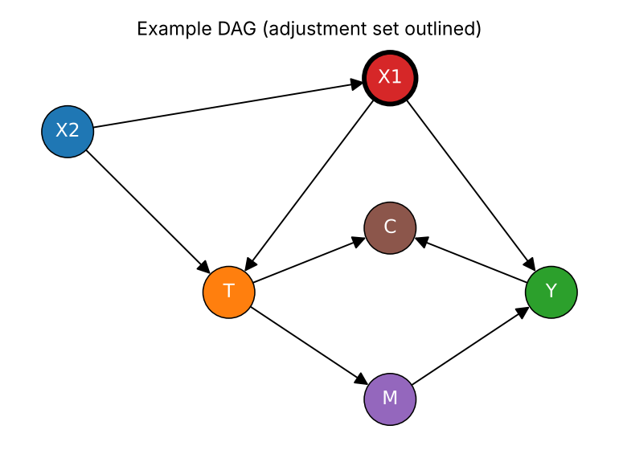
</p>

<p align="center">
  <em>Example causal graph used to reason about confounding paths and adjustment requirements.</em>
</p>

### 2. Data validation and ingestion

Implemented in `data/` and `data/loaders/`.

- Unified `CausalDataset` schema.
- Data-quality validation.
- Covariate-balance and overlap diagnostics.
- Leakage warnings.
- Streaming Criteo ingestion with an intention-to-treat design; `exposure` is excluded from the treatment definition.
- Benchmark dataset loaders for IHDP, ACIC 2016, and LaLonde.

The benchmark loaders have been format-tested using fixtures. Full real-dataset benchmark execution remains pending.

### 3. Synthetic structural causal models

Implemented in `synthetic/generators.py`.

Configurable structural causal models (SCMs) support:

- Randomized and observational treatment assignment.
- Observed and hidden confounding.
- Linear and nonlinear relationships.
- Heterogeneous treatment effects.
- Known treatment-effect ground truth from structural equations.

This enables controlled evaluation of estimators under scenarios where the true causal effect is known.

### 4. Classical treatment-effect estimators

Implemented in `estimators/`.

- Naive difference-in-means estimation.
- Regression adjustment.
- Propensity-score estimation and diagnostics.
- Standardized mean difference (SMD).
- Effective sample size (ESS).
- Inverse probability weighting (IPW), including Hájek and Horvitz–Thompson variants.
- Explicit propensity-score trimming.
- Augmented inverse probability weighting (AIPW).
- Cross-fitted AIPW.
- Propensity-score matching (PSM), including ATT/ATE options and calipers.
- Generic bootstrap utilities.

### 5. Causal machine learning

Implemented in `meta_learners/` and `causal_ml/`.

- S-learner.
- T-learner.
- X-learner.
- Double/debiased machine learning (DML) for partially linear models.
- K-fold cross-fitting.
- Honest causal forest with R-loss-based splitting and honest leaves.

The causal forest's reported standard errors are heuristic rather than fully calibrated inferential guarantees.

### 6. Sensitivity analysis and falsification diagnostics

Implemented in `sensitivity/`.

- Cinelli–Hazlett robustness values.
- Bias-adjusted estimates.
- Permutation-based placebo testing.
- Negative-control-outcome testing.

These methods are treated as diagnostics under specified assumptions, not as automatic proof that an analysis is free from hidden confounding.

### 7. Evaluation and decision intelligence

Implemented in `evaluation/` and `decision/`.

Evaluation metrics include:

- ATE bias.
- Root mean squared error (RMSE).
- Standard deviation.
- Confidence-interval coverage and width, where available.
- Precision in estimation of heterogeneous effect (PEHE).
- Runtime.

Decision components include:

- Top-k treatment allocation.
- Budget-constrained targeting policies.
- Oracle and random-policy comparisons.
- Exact, IPW, and AIPW policy-value evaluation.

### 8. Quasi-experimental methods

Additional estimators include:

- Difference-in-Differences (DiD).
- Cluster-robust inference.
- Event-study analysis.
- Pre-trend testing.
- Two-stage least squares (2SLS).
- First-stage F-statistics.
- Cluster bootstrap.
- IPW for ATT estimation.

---

## Architecture

CausalForge is organised as a modular Python research framework. Data generation and ingestion feed into causal graph analysis, estimators, machine-learning methods, sensitivity diagnostics, and evaluation. Experiment runners persist outputs for reporting and inspection.

<p align="center">
  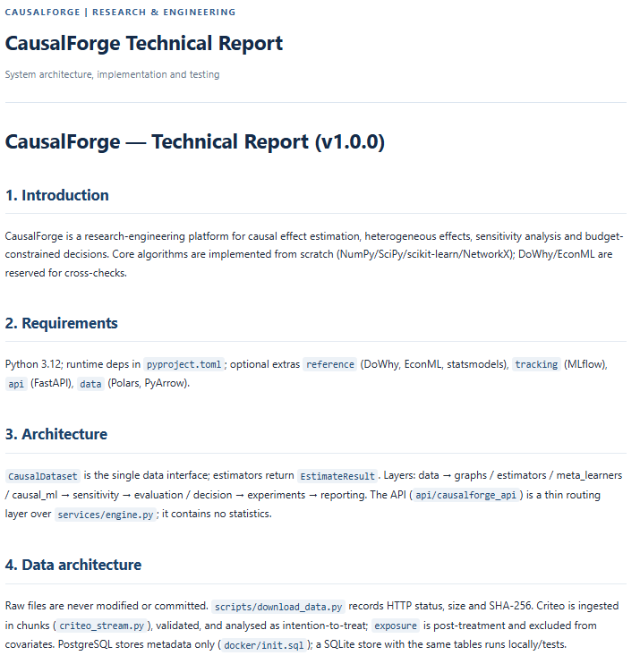
</p>

<p align="center">
  <em>Architecture evidence from the technical report, illustrating the separation of causal modelling, estimation, evaluation, and supporting application components.</em>
</p>

### Design principles

- **Modularity:** estimators, data loaders, graph operations, and evaluation components are separated.
- **Reproducibility:** experiment outputs are persisted as files, with environment metadata.
- **Ground-truth evaluation:** synthetic SCMs make controlled estimation-error analysis possible.
- **Explicit assumptions:** diagnostics and limitations are reported alongside estimates.
- **Research traceability:** experiment outputs, figures, and written reports are retained as project artifacts.

### Application and infrastructure components

The repository also contains:

- FastAPI service-layer code.
- SQLite persistence and PostgreSQL DDL.
- React dashboard source.
- Docker Compose configuration.
- Optional MLflow tracking integration.

These components are part of the implementation, but the complete API/frontend/database/container stack has **not yet been verified through an end-to-end local deployment**. They should therefore be considered included engineering components rather than a production-ready deployed service.

---

## Experimental design

The main experiment runner is:

```text
scripts/run_experiments.py
```

It executes the synthetic experiment suite and writes result files to:

```text
artifacts/results/
```

| Experiment | Focus | Main evaluation |
|---|---|---|
| EXP-01 | Classical estimators | ATE bias, RMSE, coverage, interval width |
| EXP-02 | Meta-learners | PEHE and ATE absolute error |
| EXP-03 | DML versus AIPW | Estimation accuracy and uncertainty |
| EXP-03b | Causal forest and meta-learners | PEHE and pointwise coverage |
| EXP-04 | Randomized versus observational assignment | Estimator performance under different assignment mechanisms |
| EXP-05 | Observed confounding | Bias as confounding strength changes |
| EXP-06 | Hidden confounding | Observed-covariate versus oracle estimation |
| EXP-06b | Permutation placebo | Placebo estimates and rejection rates |
| EXP-07 | Sample-size sensitivity | Estimation accuracy across sample sizes |
| EXP-08 | Policy evaluation | Value under different treatment budgets |
| EXP-09 | Negative-control outcome | Rejection behaviour under hidden confounding |
| EXP-10 | Difference-in-Differences | Parallel-trends and violated-trends scenarios |
| EXP-11 | Instrumental variables | Strong/weak instruments and exclusion violations |

The experiment outputs are synthetic simulation results. They should not be interpreted as empirical performance guarantees on real-world datasets.

---

## Selected experimental findings

The following findings are from the local synthetic experiment runs. Values are reported for the stated simulation settings and should be interpreted within those settings.

### Confounding and estimator behaviour — EXP-05

In the confounding experiment (`n = 2,000`, 100 replications), naive estimation bias increased as confounding strength increased:

| Confounding strength | Naive bias |
|---:|---:|
| 0.5 | 0.35 |
| 1.0 | 0.63 |
| 2.0 | 0.94 |
| 3.0 | 1.07 |

AIPW remained close to zero bias in the reported scenarios, with absolute bias no greater than approximately 0.007.

This illustrates how adjustment for observed confounders can improve estimation in the specified SCM. It does not establish that AIPW can remove unobserved confounding.

### Classical estimators — EXP-01

Under the observed-confounding scenarios, regression adjustment, IPW, AIPW, and PSM generally performed better than naive estimation.

The experiment also showed that IPW confidence intervals could be conservative in some settings. In particular, propensity-estimation uncertainty is not fully represented by every standard-error calculation used in the experiment.

Coverage is therefore reported as an empirical simulation diagnostic, not as a universal property of IPW.

### Meta-learners — EXP-02

For the linear SCM (`n = 2,000`, 30 replications), the reported PEHE values were:

| Learner | PEHE |
|---|---:|
| S-learner | 0.252 |
| X-learner | 0.325 |
| T-learner | 0.487 |

For the nonlinear SCM:

| Learner | PEHE |
|---|---:|
| S-learner | 0.289 |
| X-learner | 0.326 |
| T-learner | 0.537 |

These results reflect the heterogeneity structure and base learners used by this simulator. They should not be interpreted as a general ranking of meta-learning algorithms.

### Hidden confounding — EXP-06

The observed-covariate AIPW estimator became increasingly biased as hidden-confounding strength increased. The oracle estimator, which additionally observes the hidden variable `U`, remained close to unbiased in the simulated settings.

A key finding concerns the interpretation of robustness values:

- The mean robustness value increased from approximately 0.36 to 0.52 as hidden confounding worsened.
- This occurred because the biased estimate itself became larger and appeared more robust under the metric.
- A robustness value quantifies the strength of unobserved confounding required to explain away an estimate under its assumptions. **It does not detect whether hidden confounding is present.**

The permutation placebo test also did not reliably identify the hidden confounding scenarios in this experiment. A non-significant placebo result is not evidence that an observational study is unconfounded.

### Honest causal forest — EXP-03b

The honest forest achieved lower PEHE than the compared T- and X-learners in the reported randomized and observational nonlinear scenarios.

However, measured pointwise interval coverage was approximately 0.69 and 0.665. This is below nominal 95% coverage and is an important limitation of the current heuristic uncertainty estimates.

### Policy evaluation — EXP-08

In the randomized nonlinear SCM (`n = 4,000`, 20 replications), X- and T-learner targeting policies approached the oracle policy and outperformed random targeting over the evaluated budgets.

The reported IPW policy-value estimate (0.945) was close to the exact value (0.943), with a mean absolute gap of approximately 0.034.

### Difference-in-Differences — EXP-10

| Scenario | Bias | Coverage | Pre-trend rejection |
|---|---:|---:|---:|
| Parallel trends | -0.004 | 0.97 | 0.02 |
| Violated trends | 0.896 | 0.00 | 1.00 |

The experiment illustrates the importance of the parallel-trends assumption. When the simulated assumption was violated, the estimated effect became substantially biased.

### Instrumental variables — EXP-11

| Method | Bias | RMSE | Mean first-stage F |
|---|---:|---:|---:|
| 2SLS, strong instrument | Approximately 0.000 | 0.039 | 505.1 |
| 2SLS, weak instrument | -0.280 | 2.180 | 4.3 |

The experiment also included an exclusion-restriction violation scenario. A strong first stage alone does not establish instrument validity: instrument relevance and the exclusion restriction are different assumptions.

### Additional experiment findings

- **EXP-09 — Negative control:** the negative-control-outcome diagnostic rejected in 100% of the reported hidden-confounding scenarios, compared with 12% under no hidden confounding. This behaviour is specific to the simulated negative-control construction.
- **EXP-07 — Sample size:** evaluates how bias, RMSE, and interval behaviour change across sample sizes.
- **EXP-03 — DML versus AIPW:** compares cross-fitted estimators under the configured simulation scenarios.

Full experiment tables are available in [`reports/benchmark_report/benchmark_report.md`](reports/benchmark_report/benchmark_report.md).

---

## Visual evidence

The screenshots below are generated from the local project artifacts and reports. Each image is included to show a specific part of the implementation or experimental analysis.

### Experiment execution

<p align="center">
  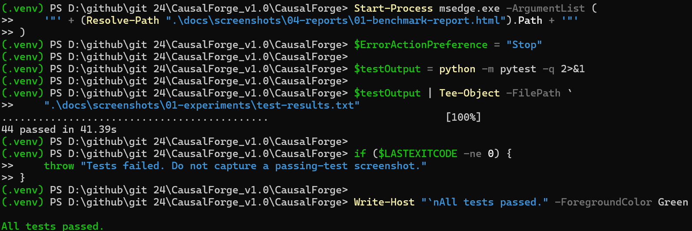
</p>

<p align="center">
  <em>Local test evidence: 44 tests passed. This is the recorded test-suite result, not a claim that every optional application component has been deployed.</em>
</p>

<p align="center">
  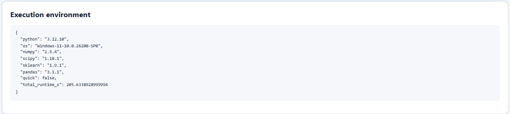
</p>

<p align="center">
  <em>Environment metadata retained alongside the experiment outputs to support reproducibility and result traceability.</em>
</p>

### Benchmark figures

<p align="center">
  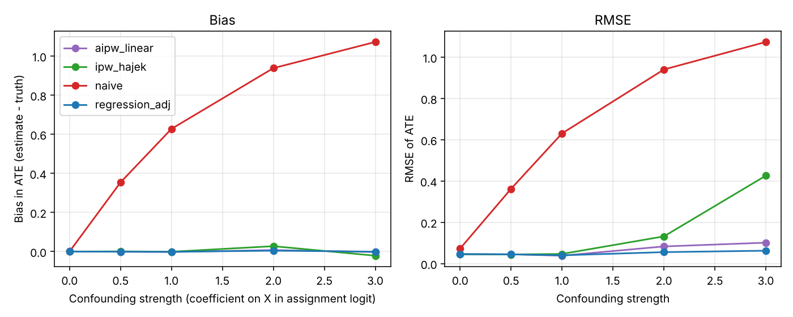
</p>

<p align="center">
  <em>Confounding-bias experiment: compares how estimator bias changes under different confounding strengths.</em>
</p>

<p align="center">
  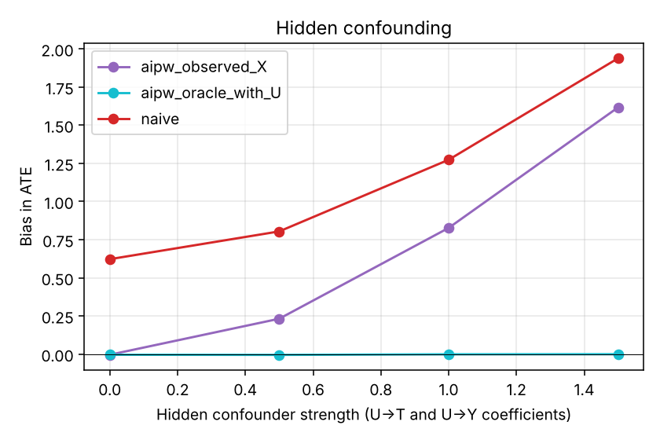
</p>

<p align="center">
  <em>Hidden-confounding experiment: contrasts estimation using observed covariates with an oracle setting that also observes the hidden variable.</em>
</p>

<p align="center">
  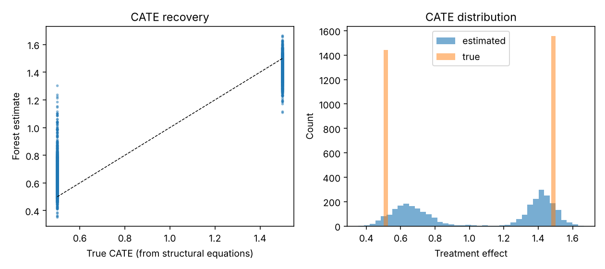
</p>

<p align="center">
  <em>Heterogeneous treatment-effect evidence: visualises estimated conditional treatment effects from the causal-forest experiment.</em>
</p>

<p align="center">
  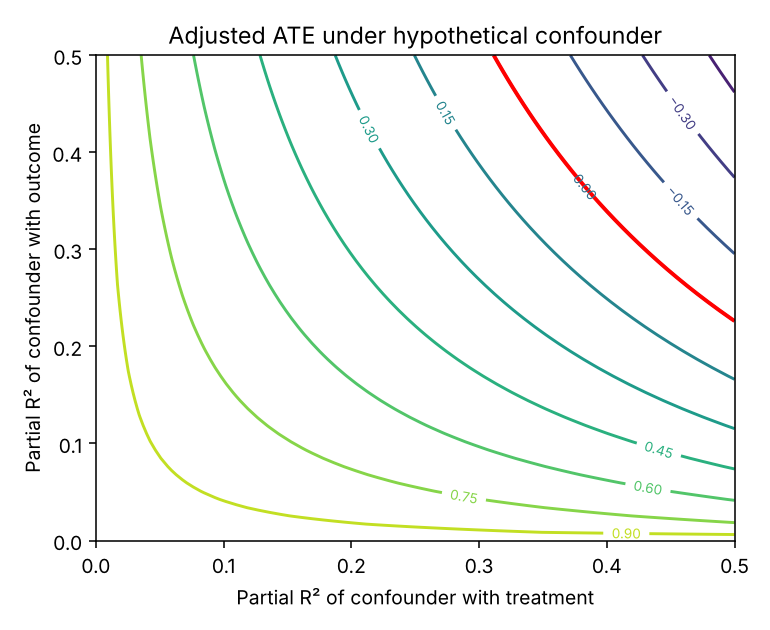
</p>

<p align="center">
  <em>Sensitivity analysis: shows how the estimated effect changes across specified levels of unobserved-confounding strength.</em>
</p>

<p align="center">
  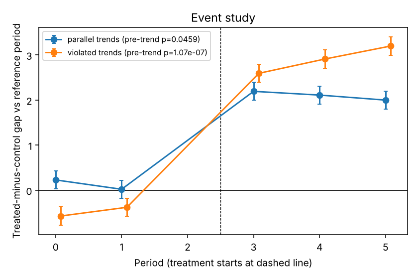
</p>

<p align="center">
  <em>Event-study evidence: examines treatment-effect dynamics and pre-treatment behaviour in the DiD simulation.</em>
</p>

### Research and engineering reports

<p align="center">
  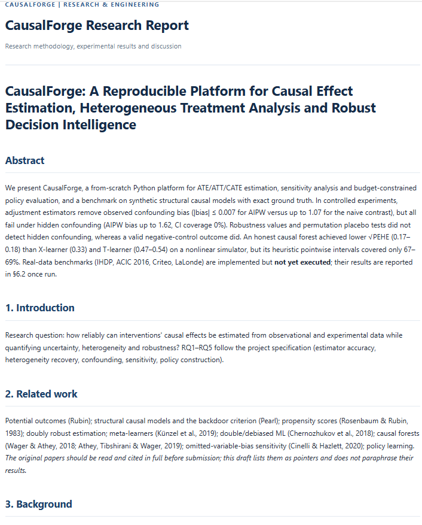
</p>

<p align="center">
  <em>Research report: introduces the study, its motivation, and the scope of the experimental investigation.</em>
</p>

<p align="center">
  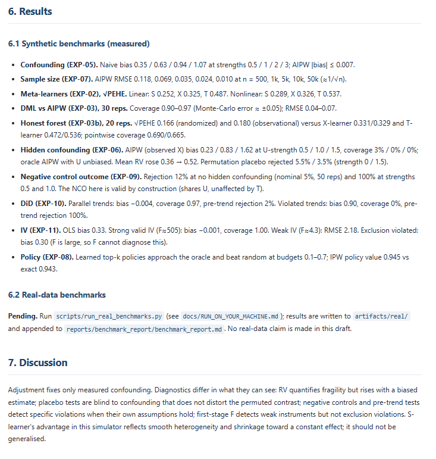
</p>

<p align="center">
  <em>Research report: presents the experimental findings and their interpretation.</em>
</p>

<p align="center">
  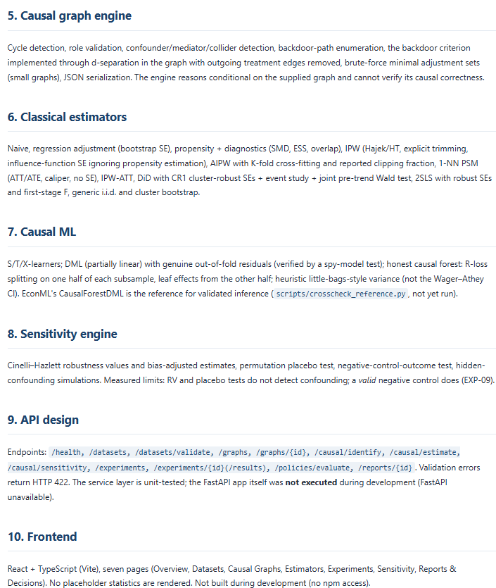
</p>

<p align="center">
  <em>Technical report: documents implementation and engineering decisions behind the framework.</em>
</p>

For the complete figure collection, see [`docs/screenshots/02-benchmarks/`](docs/screenshots/02-benchmarks/), [`docs/screenshots/03-causal-graphs/`](docs/screenshots/03-causal-graphs/), and [`docs/screenshots/04-reports/`](docs/screenshots/04-reports/).

---

## Repository structure

```text
CausalForge/
├── artifacts/
│   └── results/                 # Experiment CSV outputs and environment metadata
├── configs/                     # Experiment and project configuration
├── data/                        # Dataset schemas, validation and loaders
├── docs/
│   ├── methodology/             # Causal assumptions and methodological notes
│   ├── screenshots/             # Experiment, benchmark, graph and report evidence
│   └── RUN_ON_YOUR_MACHINE.md   # Real-dataset execution instructions
├── experiments/                 # Synthetic and real-data experiment runners
├── notebooks/                   # Research and exploratory notebooks
├── reports/
│   ├── benchmark_report/        # Benchmark report and figures
│   ├── research_report/         # Research-oriented report
│   └── technical_report/        # Technical implementation report
├── scripts/
│   ├── run_experiments.py       # Main synthetic experiment runner
│   ├── generate_report.py       # Report and figure generation
│   └── download_data.py         # Dataset download utility
├── src/
│   └── causalforge/
│       ├── api/
│       ├── causal_ml/
│       ├── data/
│       ├── decision/
│       ├── estimators/
│       ├── evaluation/
│       ├── experiments/
│       ├── graphs/
│       ├── meta_learners/
│       ├── reporting/
│       ├── sensitivity/
│       └── synthetic/
├── tests/                       # Automated tests
├── frontend/                    # React dashboard source
├── docker/                      # Container configuration
├── pyproject.toml
└── README.md
```

---

## Local setup

### Requirements

- Windows, Linux, or macOS.
- Python **3.12** (the project targets Python `>=3.12,<3.13`).
- Git.
- Internet access for installing dependencies and downloading optional real datasets.

### 1. Clone the repository

```bash
git clone <YOUR_REPOSITORY_URL>
cd CausalForge
```

Replace `<YOUR_REPOSITORY_URL>` with the actual GitHub repository URL.

### 2. Create and activate a virtual environment

**Windows PowerShell**

```powershell
py -3.12 -m venv .venv
.\.venv\Scripts\Activate.ps1
```

**Linux / macOS**

```bash
python3.12 -m venv .venv
source .venv/bin/activate
```

### 3. Install the project

```bash
python -m pip install --upgrade pip
python -m pip install -e ".[dev]"
```

### 4. Run the test suite

```bash
python -m pytest -q
```

Expected result from the recorded local run:

```text
44 passed
```

### 5. Check the environment

```bash
python -m pip check
python -m compileall -q src
```

The recorded local checks completed successfully:

- No broken package requirements reported by `pip check`.
- Python source compilation completed without errors.

---

## Running experiments

The main synthetic experiment suite can be executed from the repository root.

**Windows PowerShell**

```powershell
$env:PYTHONPATH = "src"
python scripts\run_experiments.py
```

**Linux / macOS**

```bash
PYTHONPATH=src python scripts/run_experiments.py
```

The experiment runner writes CSV files and environment metadata to:

```text
artifacts/results/
```

The recorded local run produced 14 CSV files and one environment metadata file. One CSV, `exp08_ipw_check.csv`, was empty; it should not be interpreted as containing a completed set of result rows.

To inspect the output files:

```powershell
Get-ChildItem .\artifacts\results -File |
    Select-Object Name, Length
```

To regenerate the benchmark figures and report:

```powershell
$env:PYTHONPATH = "src"
python scripts\generate_report.py
```

For real-dataset execution, follow [`docs/RUN_ON_YOUR_MACHINE.md`](docs/RUN_ON_YOUR_MACHINE.md). Dataset downloads require internet access and may involve additional storage and runtime requirements.

---

## Results and reports

CausalForge retains experiment outputs separately from the written interpretation.

| Artifact | Location | Purpose |
|---|---|---|
| Experiment outputs | `artifacts/results/` | CSV metrics for the synthetic experiment suite |
| Environment metadata | `artifacts/results/environment.json` | Recorded execution environment |
| Benchmark report | `reports/benchmark_report/benchmark_report.md` | Consolidated experiment findings |
| Benchmark figures | `reports/benchmark_report/figures/` | Generated plots with written captions |
| Research report | `reports/research_report/causalforge_research_report.md` | Research questions, methodology, results, discussion, and references |
| Technical report | `reports/technical_report/causalforge_technical_report.md` | Architecture, implementation, testing, and deployment notes |
| Screenshot evidence | `docs/screenshots/` | Selected visual evidence from local execution and reports |

The reports distinguish synthetic results from real-dataset evaluation. Real-data result sections remain pending until the relevant datasets have been downloaded and the benchmark runs completed.

---

## Validation status

The following table separates locally verified work from components that still need additional execution.

| Area | Status | Evidence / qualification |
|---|---|---|
| Core Python package | Implemented | Source package under `src/causalforge/` |
| Automated tests | Verified | 44 tests passed |
| Python source compilation | Verified | `python -m compileall -q src` completed |
| Dependency consistency | Verified | `python -m pip check` reported no broken requirements |
| Synthetic experiments EXP-01 to EXP-11 | Executed | CSV outputs under `artifacts/results/` |
| Benchmark figures and reports | Generated | Files under `reports/` |
| Research and technical reports | Written | Local Markdown reports |
| Eight research notebooks | Executed and checked | As recorded in the project validation work |
| IHDP / ACIC / LaLonde / Criteo | Not yet run end-to-end | Loaders format-tested on fixtures; real-data results pending |
| FastAPI / React / Docker Compose / MLflow | Not verified as a complete running stack | Implementation files are included |
| EconML / DoWhy cross-check | Not executed | Cross-check script is included |
| Ruff / mypy | Partially checked | Outstanding findings remain; no clean full-project pass is claimed |
| Hypothesis | Configured | Not separately reported as a completed validation run |

---

## Limitations and interpretation

CausalForge is an experimental research and engineering project. Its results must be interpreted in light of the following limitations.

1. **Synthetic-data scope:** the reported results come from a limited family of low-dimensional SCMs. They do not establish performance on real, high-dimensional, or domain-specific datasets.

2. **Identification assumptions:** causal identification relies on assumptions such as consistency, conditional exchangeability, positivity, and SUTVA. The software can support diagnostics and analysis, but no algorithm in this project can automatically verify these assumptions.

3. **Unobserved confounding:** adjustment-based estimators cannot generally eliminate bias from confounders that are not observed. Sensitivity analysis quantifies aspects of this uncertainty under specified models; it does not prove that hidden confounding is absent.

4. **Propensity-score weighting:** extreme weights and limited overlap can destabilise IPW. Trimming and diagnostics are provided, but their use involves methodological trade-offs.

5. **Matching uncertainty:** PSM does not report a standard error in the current implementation. A plain bootstrap is not treated as valid for matching, and coverage is not claimed.

6. **Causal-forest uncertainty:** the current forest standard errors are heuristic. The measured pointwise coverage of approximately 0.67–0.69 is below nominal 95% coverage in the reported experiments.

7. **DML estimand:** the partially linear DML implementation targets a variance-weighted effect under treatment-effect heterogeneity, not necessarily the population ATE.

8. **Monte Carlo uncertainty:** coverage and error summaries based on 20–30 replications can have substantial Monte Carlo variability. Small differences between methods should not be overinterpreted.

9. **Diagnostic limitations:** placebo tests, negative controls, pre-trend tests, and first-stage statistics each address particular failure modes. Passing one diagnostic does not establish the validity of an entire causal design.

10. **Real-data validation:** IHDP, ACIC 2016, LaLonde, and Criteo benchmarks remain to be run end-to-end before drawing conclusions about real-world performance.

---

## Roadmap

Potential next steps for extending the project include:

- Run the IHDP, ACIC 2016, LaLonde, and Criteo benchmarks and retain reproducible result artifacts.
- Expand evaluation to additional data-generating processes and higher-dimensional settings.
- Improve uncertainty calibration for heterogeneous treatment-effect models.
- Add stronger validation of overlap, positivity, and sensitivity-analysis assumptions.
- Complete end-to-end verification of the API, frontend, and containerised stack.
- Execute and document EconML / DoWhy cross-checks.
- Expand experiment tracking and reproducibility metadata.
- Add further robustness and falsification experiments.

---

## License and data

### Source code

The project source code is distributed under the MIT License. See [`LICENSE`](LICENSE).

### Dataset considerations

- Raw benchmark datasets are not committed to the repository.
- Dataset downloads are handled separately from source code.
- Criteo data is subject to **CC BY-NC-SA 4.0** and must be used in accordance with its non-commercial and attribution requirements.
- Users should review the original terms and citation requirements for each dataset before downloading or using it.

---

**CausalForge — from causal assumptions and estimation to evidence-based decision evaluation.**
